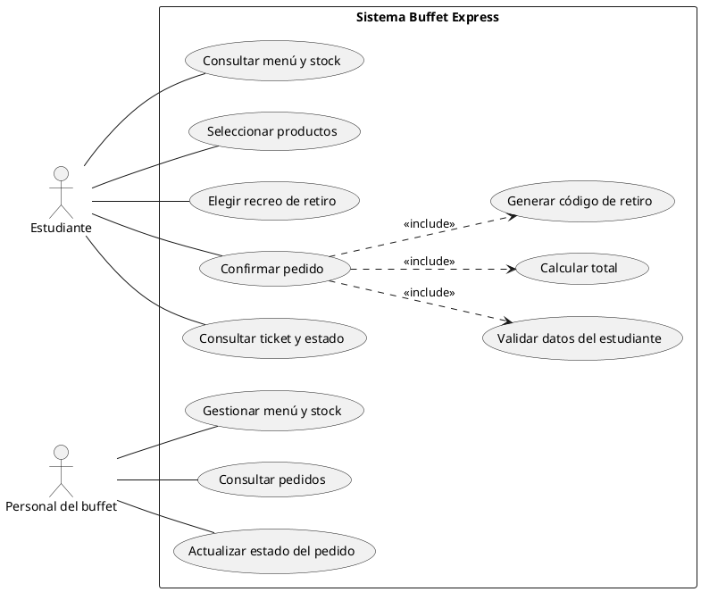

# Buffet Express

## Tablero ágil

El tablero inicial queda definido con estas columnas, en este orden:

1. Product Backlog
2. To Do (Sprint)
3. In Progress
4. Testing/QA
5. Done

Para crearlo en GitHub Projects o Trello, crea un tablero tipo Kanban y agrega las cinco columnas anteriores. Tarjetas iniciales sugeridas:

- Menú del día: productos, precios y stock.
- Creación y envío del pedido con datos del alumno e ítems.
- Confirmación del pedido y generación del código de retiro.
- Selección del horario/recreo de retiro.
- Prueba técnica de comunicación cliente-servidor (PoC).

No se creó el tablero remoto porque este workspace no tiene configurada una cuenta ni acceso a GitHub Projects o Trello.

## Ejercicio 1.1: Clasificación MoSCoW

| # | Característica | Prioridad | Motivo |
|---|---|---|---|
| 1 | Visualización del menú del día con precios y stock disponible | **Must Have** | Es necesario para que el alumno conozca qué puede pedir y para evitar ofrecer productos sin stock. |
| 2 | Pago mediante reconocimiento facial y biométrico | **Won't Have** (alcance inicial) | Se excluye del lanzamiento inicial por complejidad y por el tratamiento de datos biométricos. |
| 3 | Ticket digital con código único de retiro | **Must Have** | Permite identificar y entregar cada pedido correctamente. |
| 4 | Chat en vivo entre el alumno y el cocinero para personalizar condimentos | **Could Have** | Aporta flexibilidad, pero la personalización puede resolverse inicialmente con opciones predefinidas. |
| 5 | Selección del horario/recreo de retiro | **Should Have** | Ayuda a organizar la preparación y entrega, aunque el servicio podría iniciar con un horario común. |
| 6 | Acumulación de puntos y beneficios de fidelización | **Could Have** | Mejora la recurrencia, pero no es necesaria para operar el MVP. |

## Ejercicio 1.2: PoC cliente-servidor en C#

La prueba levanta un endpoint HTTP simulado en `localhost`, envía el pedido como JSON y verifica el estado HTTP y todos los campos de la respuesta, incluido el código de retiro.

Requiere el SDK de .NET 10. Ejecuta desde la raíz del proyecto:

```bash
dotnet run --project poc-pedido
```

La respuesta esperada incluye `status: 200`, `mensaje: "Pedido recibido con éxito"`, `codigo_retiro: "BE-8842"` y `tiempo_estimado_entrega: "10:15 AM"`.

## Actividad 2: Requerimientos, UML, APIs y control de calidad

### Ejercicio 2.1: Historia de usuario HU-02

**HU-02 - Confirmación de Pedido Anticipado**

**Como** estudiante del colegio, **quiero** confirmar mi pedido seleccionando el recreo de retiro, **para** organizar la entrega y recibirlo en el momento elegido.

**Criterio de aceptación**

- **Dado** que seleccioné 1 Sándwich de Milanesa por $3.500 ARS.
- **Cuando** presiono el botón "Confirmar Pedido".
- **Entonces** el sistema solicita y valida mi nombre completo, curso/división y recreo de retiro; muestra el resumen del pedido por $3.500 ARS y genera un código de retiro único de 4 dígitos.

### Tarjeta para el backlog (Issue)

**Título:** HU-02 - Confirmación de Pedido Anticipado

**Descripción:** Como estudiante del colegio, quiero confirmar mi pedido indicando el recreo de retiro, para organizar la entrega y recibirlo en el momento elegido.

**Criterios de aceptación:**

- Solicita nombre completo, curso/división y recreo de retiro antes de confirmar.
- Muestra el producto seleccionado y el total de $3.500 ARS para que el estudiante revise el pedido.
- Al confirmar, crea el pedido y genera un código de retiro único de 4 dígitos.
- Si falta alguno de los datos requeridos, informa cuál debe completarse y no confirma el pedido.

**Columna inicial sugerida:** Product Backlog.

### Diagrama UML de casos de uso



El diagrama puede renderizarse con PlantUML. La tarjeta queda especificada para crearla en GitHub Projects o Trello; no se publicó un Issue remoto porque no hay una cuenta conectada en este workspace.# Buffet-Express
