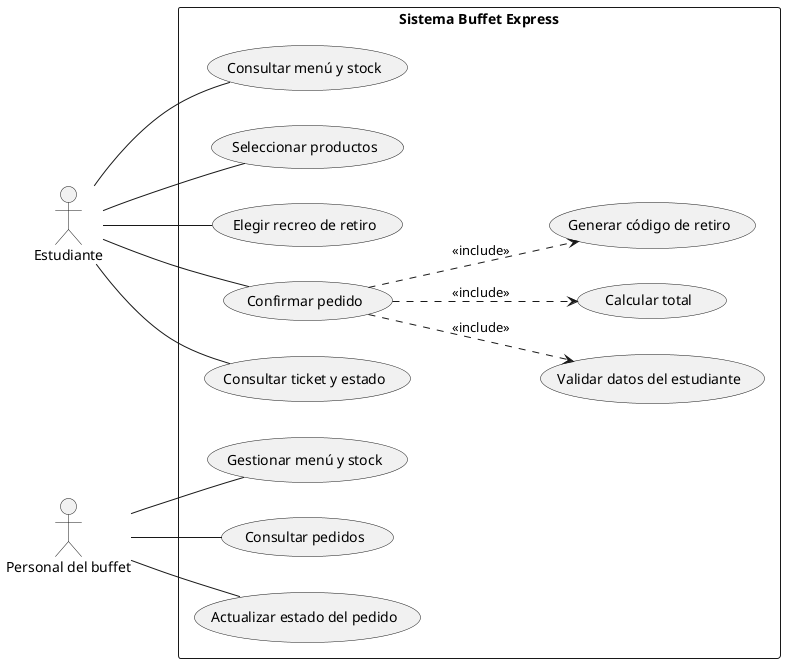

# Buffet Express

## Tablero ágil

El tablero inicial queda definido con estas columnas, en este orden:

1. Product Backlog
2. To Do (Sprint)
3. In Progress
4. Testing/QA
5. Done

Para crearlo en GitHub Projects o Trello, crea un tablero tipo Kanban y agrega las cinco columnas anteriores. Tarjetas iniciales sugeridas:

- Menú del día: productos, precios y stock.
- Creación y envío del pedido con datos del alumno e ítems.
- Confirmación del pedido y generación del código de retiro.
- Selección del horario/recreo de retiro.
- Prueba técnica de comunicación cliente-servidor (PoC).

No se creó el tablero remoto porque este workspace no tiene configurada una cuenta ni acceso a GitHub Projects o Trello.

## Ejercicio 1.1: Clasificación MoSCoW

| # | Característica | Prioridad | Motivo |
|---|---|---|---|
| 1 | Visualización del menú del día con precios y stock disponible | **Must Have** | Es necesario para que el alumno conozca qué puede pedir y para evitar ofrecer productos sin stock. |
| 2 | Pago mediante reconocimiento facial y biométrico | **Won't Have** (alcance inicial) | Se excluye del lanzamiento inicial por complejidad y por el tratamiento de datos biométricos. |
| 3 | Ticket digital con código único de retiro | **Must Have** | Permite identificar y entregar cada pedido correctamente. |
| 4 | Chat en vivo entre el alumno y el cocinero para personalizar condimentos | **Could Have** | Aporta flexibilidad, pero la personalización puede resolverse inicialmente con opciones predefinidas. |
| 5 | Selección del horario/recreo de retiro | **Should Have** | Ayuda a organizar la preparación y entrega, aunque el servicio podría iniciar con un horario común. |
| 6 | Acumulación de puntos y beneficios de fidelización | **Could Have** | Mejora la recurrencia, pero no es necesaria para operar el MVP. |

## Ejercicio 1.2: PoC cliente-servidor en C#

La prueba levanta un endpoint HTTP simulado en `localhost`, envía el pedido como JSON y verifica el estado HTTP y todos los campos de la respuesta, incluido el código de retiro.

Requiere el SDK de .NET 10. Ejecuta desde la raíz del proyecto:

```bash
dotnet run --project poc-pedido
```

La respuesta esperada incluye `status: 200`, `mensaje: "Pedido recibido con éxito"`, `codigo_retiro: "BE-8842"` y `tiempo_estimado_entrega: "10:15 AM"`.

## Actividad 2: Requerimientos, UML, APIs y control de calidad

### Ejercicio 2.1: Historia de usuario HU-02

**HU-02 - Confirmación de Pedido Anticipado**

**Como** estudiante del colegio, **quiero** confirmar mi pedido seleccionando el recreo de retiro, **para** organizar la entrega y recibirlo en el momento elegido.

**Criterio de aceptación**

- **Dado** que seleccioné 1 Sándwich de Milanesa por $3.500 ARS.
- **Cuando** presiono el botón "Confirmar Pedido".
- **Entonces** el sistema solicita y valida mi nombre completo, curso/división y recreo de retiro; muestra el resumen del pedido por $3.500 ARS y genera un código de retiro único de 4 dígitos.

### Tarjeta para el backlog (Issue)

**Título:** HU-02 - Confirmación de Pedido Anticipado

**Descripción:** Como estudiante del colegio, quiero confirmar mi pedido indicando el recreo de retiro, para organizar la entrega y recibirlo en el momento elegido.

**Criterios de aceptación:**

- Solicita nombre completo, curso/división y recreo de retiro antes de confirmar.
- Muestra el producto seleccionado y el total de $3.500 ARS para que el estudiante revise el pedido.
- Al confirmar, crea el pedido y genera un código de retiro único de 4 dígitos.
- Si falta alguno de los datos requeridos, informa cuál debe completarse y no confirma el pedido.

**Columna inicial sugerida:** Product Backlog.

### Diagrama UML de casos de uso



El diagrama puede renderizarse con PlantUML. La tarjeta queda especificada para crearla en GitHub Projects o Trello; no se publicó un Issue remoto porque no hay una cuenta conectada en este workspace.# Buffet-Express

## Punto de partida: reflexión sobre el problema

Respuestas modelo para adaptar a la experiencia y los datos reales de cada estudiante y escuela.

### 1. Experiencia con las filas

**Modelo para personalizar:** “Sí, alguna vez tuve que renunciar a comprar porque la fila avanzaba muy lentamente y el recreo estaba por terminar. Eso me hizo perder la posibilidad de comprar algo y volver a clase a tiempo.” Si no te ocurrió, puedes responder: “No tuve que renunciar, pero vi que la fila era larga y que algunos compañeros no llegaban a comprar antes del timbre.”

### 2. Uso de la aplicación y recargo

**Respuesta modelo:** “Sí, probaría una aplicación que me permitiera pedir antes y retirar sin hacer la fila, siempre que el pedido estuviera listo en el horario elegido. Estaría dispuesto/a a pagar $500 ARS adicionales si el ahorro de tiempo y la entrega puntual justifican ese costo. Antes de implementarlo, convendría consultarlo mediante una encuesta para saber cuántos estudiantes aceptarían el recargo.”

### 3. Costo de perder clientes

Cada estudiante que no llega a comprar representa una venta potencial perdida. Para estimar el efecto económico se debe usar el margen de contribución por pedido, no asumir que todo el precio de venta es ganancia:

`Margen por pedido = precio de venta - costo variable del pedido`

`Margen mensual perdido = estudiantes que no compran por recreo × recreos del mes × margen por pedido`

El resultado depende de contar cuántos estudiantes abandonan la fila, de los productos que habrían comprado y de sus costos variables. El buffet puede relevar esos datos antes de proyectar ingresos.

### 4. PoC, MVP y aplicación completa

| Concepto | Objetivo | Alcance | Audiencia |
|---|---|---|---|
| **PoC** | Validar una factibilidad técnica u operativa concreta. | Prueba reducida, como enviar un pedido JSON y recibir un código de retiro. | Equipo del proyecto y responsables de evaluar la viabilidad. |
| **MVP** | Comprobar con usuarios reales si la solución central aporta valor. | Funciones indispensables: consultar menú, confirmar pedido y retirar con código. | Estudiantes y personal del buffet. |
| **Aplicación completa** | Ampliar el valor y atender una operación consolidada. | Incluye mejoras y funciones secundarias, escalabilidad e integraciones. | Comunidad de usuarios y operación del buffet a mayor escala. |

La PoC reduce el riesgo de invertir en una solución mayor antes de comprobar que la comunicación cliente-servidor funciona. No demuestra por sí sola que exista demanda ni que el negocio sea rentable; esas hipótesis requieren pruebas con usuarios y análisis económico.

### 6. Ventajas de trabajar en Sprints

Los Sprints dividen el trabajo en períodos breves con un objetivo claro. Permiten priorizar lo más importante, mostrar avances, recibir comentarios frecuentes y corregir errores temprano. También hacen visible quién está trabajando en cada tarea y reducen el riesgo de descubrir problemas recién al final del proyecto.

### 7. Planteo inicial del microemprendimiento

**Idea:** ofrecer pedidos anticipados para el buffet escolar, con selección de productos y recreo de retiro, para ordenar la preparación y reducir el tiempo de espera.

**Misión:** facilitar el acceso de los estudiantes a los productos del buffet durante los recreos mediante pedidos anticipados, y ayudar al personal a organizar la preparación y entrega.

**Objetivo general:** validar si un sistema sencillo de pedidos anticipados puede mejorar la experiencia de compra y la organización del buffet.

**Objetivos iniciales:** relevar hábitos y demanda con una encuesta; probar el envío de pedidos con la PoC; definir las funciones del MVP; y medir pedidos entregados a tiempo, adopción y satisfacción.

**Ubicación:** operación física en el buffet de la escuela y acceso digital desde los teléfonos de los estudiantes, sujeto a las reglas de uso de dispositivos y conectividad de la institución.

**Organización preliminar:** el concesionario administra menú, stock y preparación; el Product Owner prioriza necesidades; el Scrum Master facilita el proceso de trabajo; y el equipo de desarrollo diseña, implementa y prueba la solución. Estudiantes y personal del buffet participan como usuarios de validación.

**Puntos a favor:** problema frecuente y observable, usuarios concentrados en la escuela, posibilidad de validar con una PoC de bajo costo y beneficio potencial para estudiantes y buffet.

**Desafíos por validar:** acceso a Internet y dispositivos, aceptación del pedido anticipado, capacidad de preparación antes del recreo, coordinación de pagos y retiros, protección de datos y autorización de la institución.
